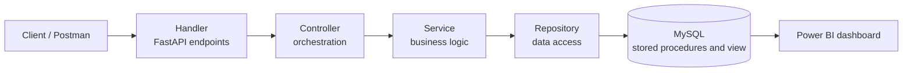

<h1 align="center">Merkadit – Gastronomic Market Management</h1>

<p align="center">
  Merkadit is a database and REST API to manage gastronomic markets and the businesses inside them: point-of-sale registration, automatic commission calculation, monthly settlement of each business, and financial reports in Power BI.
</p>

<p align="center">
  
  
  
  
  
  
</p>

<p align="center">
  <a href="#project-description">Description</a> ·
  <a href="#database-design">Database</a> ·
  <a href="#4-layer-architecture">Architecture</a> ·
  <a href="#api-endpoints">API</a> ·
  <a href="#how-to-run">Installation</a> ·
  <a href="#testing">Testing</a>
</p>

---

## Professor
* Rodrigo Nuñez Nuñez

## Authors
* Dylan Gabriel Chacon Berrocal, 2023171126
* Christopher Daniel Vargas Villalta, 2024108443

---

## Project Description

Merkadit is a management system for gastronomic markets and businesses that allows:
- Sales registration with a point of sale (POS)
- Automatic calculation of sales commissions
- Monthly settlement of businesses
- Financial reports with Power BI
- REST API with a 4-layer architecture

---

## Technologies Stack

- **Backend:** Python 3.11 + FastAPI
- **Database:** MySQL 8.0 (Docker)
- **Database connection:** PyMySQL
- **Validation:** Pydantic
- **Reports:** Power BI Desktop
- **Testing:** Postman

---

## Database Design
- ER schema
- Sample data (database population)
- Stored procedures (`registerSale` and `settleCommerce`)
- View: current sales per business (`vw_BusinessReport`)
- Dashboard for the view (Power BI)

The database is named `Caso1`, has **56 tables**, and every table uses the `MK` prefix (for example `MKSales` and `MKCommerces`).

| Entity group | What it covers |
|--------------|----------------|
| Profiles | Users, roles, user roles, permissions, and role permissions |
| Spaces and businesses | Markets, buildings, spaces and their types, attributes, and status, businesses, categories, and users per market and per business |
| Locations | Countries, states, cities, and addresses |
| Contracts | Contracts, contracts per business, types, status, terms, and renewals |
| Logs | System logs with types, sources, and severities |
| Inventory and products | Products, categories, brands, price history, inventory, inventory movements, and barcodes |
| Sales and invoicing | Sales, sale details, invoices, receipts, discounts, and payment methods |
| Finance and accounting | Initial investments, financial transactions, commission calculations, and monthly settlements per business |

**Stored procedures**
* `registerSale`: registers a complete sale inside a transaction. It validates that the business exists, calculates the subtotal and the 13% tax, and stores the sale, its detail, and a log entry.
* `settleCommerce`: settles a business for the current month and returns the settlement ID and a result message.

**View `vw_BusinessReport`:** for each business, the completed sales of the current month with the number of sales, items sold, total sales, commission, rent, and net balance.

**Dashboard:** `Dashboard.pbix` is the Power BI report built on the view, and [`Dashboard.pdf`](Dashboard.pdf) is an export of it. It shows the sales summary per business and four indicators: active businesses, total sales of the month, total commissions, and total net balance.

**Model history:** the `VersionesBD/` folder keeps the MySQL Workbench models (`.mwb`) of every version, PDF exports of the schema, and `Entidades.md`, the list of entities by team member. The `Esquemas Iniciales/` folder has the initial planning documents.

---

## 4-Layer Architecture
- Handler layer
- Controller layer
- Service layer
- Repository layer
- Postman models



| Layer | Responsibility |
|-------|----------------|
| Handler | FastAPI endpoints (routes and HTTP responses) |
| Controller | Orchestrates the business logic |
| Service | Complex business logic and validations |
| Repository | Data access and calls to the stored procedures |

Request and response models are defined with Pydantic in `app/models/`.

---

## API Endpoints
Interactive documentation is available at `http://localhost:8000/docs` (Swagger) and `http://localhost:8000/redoc`.

| Method | Endpoint | Description |
|--------|----------|-------------|
| `POST` | `/api/sales/register` | Register a new sale (`registerSale`) |
| `GET` | `/api/sales/{sale_id}` | Get the details of a sale |
| `GET` | `/api/sales/report/{store_name}` | Sales report of a business |
| `GET` | `/api/sales/daily/{store_name}` | Daily sales summary of a business |
| `POST` | `/api/settlements/settle` | Settle a business (`settleCommerce`) |
| `GET` | `/api/settlements/{settlement_id}` | Get a settlement |
| `GET` | `/api/settlements/history/{commerce_name}` | Settlement history of a business |
| `GET` | `/api/settlements/preview/{commerce_name}` | Preview of a settlement |
| `GET` | `/health` | API and database status |

---

## Project Structure
```text
Caso-1---BD1/
├── app/
│   ├── config/             # Database connection (PyMySQL, environment variables)
│   ├── handlers/           # FastAPI endpoints
│   ├── controllers/        # Orchestration layer
│   ├── services/           # Business logic
│   ├── repositories/       # Data access and stored procedures
│   └── models/             # Pydantic request and response models
├── sql/
│   ├── script_creation.sql # Schema and the 56 tables
│   ├── sample_data.sql     # Sample data
│   ├── stored_procedures.sql # registerSale and settleCommerce
│   └── View.sql            # vw_BusinessReport
├── TestLayers/             # Test scripts for each layer
├── tests/postman/          # Postman collection
├── VersionesBD/            # Workbench models and schema exports by version
├── Esquemas Iniciales/     # Initial planning documents
├── Dashboard.pbix          # Power BI report
├── Dashboard.pdf           # Dashboard export
├── main.py                 # FastAPI application
├── requirements.txt
└── .env.example
```

---

## How To Run

### Prerequisites
* Python 3.11
* MySQL 8.0 (a local installation or a Docker container)
* Power BI Desktop (only to open `Dashboard.pbix`)

### Quick start
1. Clone the repository and install the dependencies:
   ```bash
   python -m venv venv
   venv\Scripts\activate
   pip install -r requirements.txt
   ```
2. Start MySQL. With Docker, for example:
   ```bash
   docker run --name merkadit-mysql -e MYSQL_ROOT_PASSWORD=your_password -p 3306:3306 -d mysql:8.0
   ```
3. Create the database by running the scripts in `sql/` in this order:
   1. `script_creation.sql`
   2. `sample_data.sql`
   3. `stored_procedures.sql`
   4. `View.sql`
4. Copy `.env.example` to `.env` and set your MySQL password in `DB_PASSWORD`.
5. Start the API from the repository root:
   ```bash
   uvicorn main:app --reload --port 8000
   ```
6. Open `http://localhost:8000/docs` to try the endpoints, or `http://localhost:8000/health` to check the database connection.

### Notes
* `sample_data.sql` generates random sales for June to September 2024 (for three businesses) with the `GenerateRandomSales` procedure, so the values change every time it is run. It also deletes the existing sales before generating them.
* The view `vw_BusinessReport` only shows the sales of the **current month**, so it will be empty after loading the sample data until you register new sales (for example with `POST /api/sales/register`).
* The `.env` file is ignored by Git. Never commit your real password.
* Authentication and rate limiting are not implemented, and CORS is open to every origin: this is an educational project.

---

## Testing
* **Postman:** import `tests/postman/Merkadit API - Caso 1.postman_collection.json`. It contains the sales requests (register, get by ID, report, and daily summary) and the settlement requests (settle, get by ID, history, and preview).
* **Layer tests:** `TestLayers/` has one script per layer: connection, repositories, services, controllers, and stored procedures. Run them from the repository root with the database running, for example:
  ```bash
  python -m TestLayers.test_connection
  python -m TestLayers.test_storedpro
  ```
